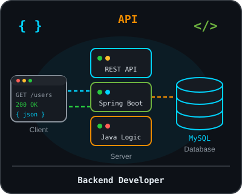

<!-- ═══════════════ HEADER (wave) ═══════════════ -->


<!-- ═══════════════ TYPING ANIMATION ═══════════════ -->
<div align="center">
  
</div>

<!-- ═══════════════ SOCIAL BADGES (shields.io + simple-icons) ═══════════════ -->
<div align="center">
  <br/>
  <a href="https://www.linkedin.com/in/rajkumar-296531216"></a>
  <a href="https://instagram.com/raj_sharma772"></a>
  <a href="mailto:rajsharma2278608@gmail.com"></a>
  <a href="https://drive.google.com/file/d/1stKQOkIHg3NvyTfG2Qb7PcH0_8nOT2wY/view?usp=sharing"></a>
  <br/><br/>
  
  
  
</div>

<!-- ═══════════════ DIVIDER ═══════════════ -->


## 👨‍💻 About Me



```java
public class RajSharma {

    String role      = "Java Backend Developer";
    String location  = "India 🇮🇳";
    String[] focus   = {"Spring Boot", "REST APIs", "Microservices", "MySQL"};
    String learning  = "Front-End • Multithreading & Concurrency";
    String funFact   = "Dil to bacha hai ji 😉";

    boolean openToCollab() { return true; }
}
```

- 🔭 Currently working on **Spring Boot backend projects**
- 🌱 Currently learning **Front-End development**
- 👯 Looking to collaborate on **Spring Boot projects**
- 💬 Ask me about **Java development**
- 📫 Reach me at **rajsharma2278608@gmail.com**

<br clear="right"/>


## 🛠️ Languages & Tools

<div align="center">


<br/>


<br/>


<br/>


</div>


## 📊 GitHub Stats

<div align="center">
  
  
  <br/>
  
</div>

<!-- Profile summary cards -->
<div align="center">
  
  
</div>

## 🏆 Trophies

<div align="center">
  
</div>

## 📈 Activity Graph

<div align="center">
  
</div>


## 📌 Featured Projects

<!-- Replace REPO_1 / REPO_2 with your actual repository names -->
<div align="center">
  <a href="https://github.com/rajsharma-java/REPO_1"></a>
  <a href="https://github.com/rajsharma-java/REPO_2"></a>
</div>

## 💬 Quote & Joke of the Moment

<div align="center">
  
  <br/>
  
</div>

<!-- ═══════════════ FOOTER (wave) ═══════════════ -->
<div align="center">

**⭐ Like my work? Give my repositories a star!**

</div>


